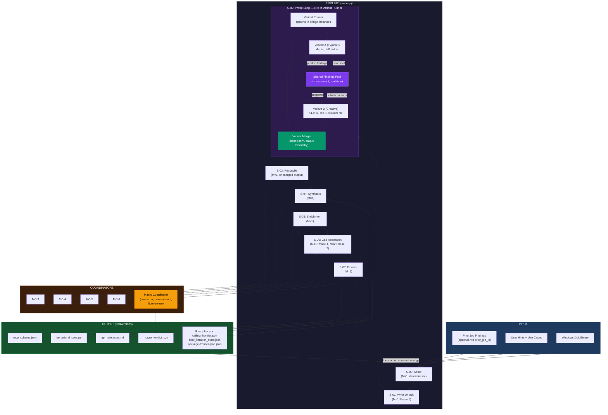

# MCP Factory — Full Pipeline Flow

> Explanatory mirror only.
> Use `api/pipeline/README.md` and `api/pipeline/sNN_*/` for live stage truth.
> Use `api/pipeline/core/handoff_contract.py` for transition and stage-contract registry truth.
> Use `docs/architecture/stage_split/` for migration doctrine.
>
> All 8 stage flowcharts combined into one view.
> For individual stage details, see `api/pipeline/s{NN}_{name}/FLOW.md`.
> Historical N x M notes now live under `docs/architecture/_archive/oldstuff/NXM-EXPANSION-ARCHITECTURE.md`.
> For floor-to-ceiling package control, also see `api/pipeline/core/floor_iteration.py`
> and `api/pipeline/core/package_frontier_planner.py`.

---

## System Overview

---

## Full Pipeline — Stage by Stage

```mermaid
flowchart TD
    %% ═══ S-00: SETUP ═══════════════════════════════════════
    DLL["DLL Binary Upload"] --> CALIB["Sentinel Calibration<br/>(call each fn with garbage, record error codes)"]
    CALIB --> SENT_MAP["Sentinel Error Map"]
    SENT_MAP --> VOCAB["Vocab Seeding<br/>(LLM infers test values from fn signatures)"]
    VOCAB --> VOCAB_DB["Vocab DB<br/>(customer IDs, amounts, codes)"]
    VOCAB_DB --> STATIC["Static Analysis<br/>(PE/IAT, string extraction, Capstone)"]
    STATIC --> FLOSS_STEP["FLOSS Extraction<br/>(XOR/stack/tight-loop strings)"]
    FLOSS_STEP --> RECLASS["Direction Reclassification<br/>(fix Ghidra byte*/char* out→in)"]
    RECLASS --> CALLGRAPH_STEP["Call Graph Construction<br/>(Ghidra XREF → dependency DAG)"]
    CALLGRAPH_STEP --> DTM_STEP["Data Type Extraction<br/>(structs, enums, typedefs)"]
    DTM_STEP --> CTX_S00["Foundational ExploreContext"]

    %% ═══ S-01: WRITE-UNLOCK ════════════════════════════════
    CTX_S00 --> CLASSIFY["Classify Write vs Read Functions"]
    CLASSIFY --> CODE_REASON["LLM Code Reasoning<br/>(analyze decompiled C for init guards)"]
    CODE_REASON --> SWEEP["Init Mode Sweep (0–64)"]
    SWEEP --> UNLOCK_CHK{Unlocked?}
    UNLOCK_CHK -->|Yes| RESOLVED["Write-Unlock RESOLVED"]
    UNLOCK_CHK -->|No| DEFERRED["Deferred to MC-3..MC-6"]
    RESOLVED --> CTX_S01["Context + Unlock Status"]
    DEFERRED --> CTX_S01

    %% ═══ S-02: PROBE LOOP (NxM VARIANT RUNNER) ═════════════
    CTX_S01 --> VRUNNER["Variant Runner<br/>(spawn M bridges + M contexts)"]
    VRUNNER --> VA_CURR["Variant A: Curriculum<br/>(topological)"]
    VRUNNER --> VB_CURR["Variant B: Curriculum<br/>(random)"]

    VA_CURR --> VA_PROBE["Variant A: LLM Probe Loop<br/>(o4-mini, t=0, full ctx)"]
    VB_CURR --> VB_PROBE["Variant B: LLM Probe Loop<br/>(o4-mini, t=0.3, minimal ctx)"]

    VA_PROBE --> VA_FIND["record_finding<br/>(with status hierarchy)"]
    VB_PROBE --> VB_FIND["record_finding<br/>(with status hierarchy)"]

    VA_FIND --> SFP_PUB["Publish to SFP"]
    VB_FIND --> SFP_PUB
    SFP_PUB --> SFP_POOL["Shared Findings Pool<br/>(cross-variant, real-time)"]
    SFP_POOL -->|"snapshot before each probe"| VA_PROBE
    SFP_POOL -->|"snapshot before each probe"| VB_PROBE

    VA_FIND --> VA_MORE{More fns?}
    VB_FIND --> VB_MORE{More fns?}
    VA_MORE -->|Yes| VA_PROBE
    VB_MORE -->|Yes| VB_PROBE
    VA_MORE -->|No| VMERGE
    VB_MORE -->|No| VMERGE

    VMERGE["Variant Merger<br/>(best-per-fn union, status hierarchy)"] --> MERGED_FINDINGS["Merged Findings<br/>(+ variant_contributions.json)"]
    MERGED_FINDINGS --> RECALIB["Sentinel Recalibration"]
    RECALIB --> FINDINGS_RAW["Reconciled Probe Findings"]

    %% ═══ S-03: RECONCILE + MC-3 ════════════════════════════
    FINDINGS_RAW --> RECONCILE["Reconciliation<br/>(deduplicate, resolve conflicts)"]
    RECONCILE --> MC3{"MC-3: Write Failure<br/>Classification"}
    MC3 -->|"Uniform sentinel"| MC3_SWEEP["Targeted Init Sweep"]
    MC3 -->|"Mixed sentinels"| MC3_CLASSIFY["Classify init-blocked<br/>vs arg-blocked"]
    MC3_CLASSIFY -->|"Init-blocked"| MC3_PARTIAL["Partial Init Sweep"]
    MC3_CLASSIFY -->|"Arg-blocked"| MC3_DEFER["Defer to MC-4/5/6"]
    MC3_PARTIAL --> MC3_LIVE
    MC3 -->|"Accidental success"| MC3_PATCH["Patch finding"]
    MC3_SWEEP --> MC3_LIVE["→ ctx.live_findings"]
    MC3_PATCH --> MC3_LIVE
    MC3_LIVE --> CATALOG["Sentinel Catalog<br/>(business-logic labels)"]
    MC3_DEFER --> CATALOG
    CATALOG --> FINDINGS_CLEAN["Reconciled Findings"]

    %% ═══ S-04: SYNTHESIS + MC-4 ════════════════════════════
    FINDINGS_CLEAN --> SYNTH["LLM API Reference Synthesis"]
    SYNTH --> API_REF["api_reference.md"]
    API_REF --> MC4{"MC-4: Init Clue<br/>Extraction"}
    MC4 -->|"Found init modes"| MC4_TRY["Try init modes"]
    MC4 -->|"Found dep chains"| MC4_LOG["Log for MC-5/6"]
    MC4_TRY --> CTX_S04["Context + Init Clues"]
    MC4_LOG --> CTX_S04

    %% ═══ S-05: ENRICHMENT + MC-5 ═══════════════════════════
    CTX_S04 --> BACKFILL["Schema Backfill<br/>(LLM enriches param descriptions)"]
    BACKFILL --> VERIFY["Verification<br/>(re-call verified fns, confirm descriptions)"]
    VERIFY --> MC5{"MC-5: Read→Write<br/>Chaining"}
    MC5 -->|"Extract verified IDs"| MC5_CHAIN["Chain into write fn args"]
    MC5_CHAIN --> MC5_TRY["Try ID × amount combos"]
    MC5_TRY --> MC5_LIVE["→ ctx.live_findings"]
    MC5_LIVE --> CTX_S05["Enriched Schema"]

    %% ═══ S-06: GAP RESOLUTION + MC-6 ═══════════════════════
    CTX_S05 --> GAP_AGENT["Gap Resolution Agent<br/>(LLM targets unverified fns)"]
    GAP_AGENT --> BASELINE{"Write fn?"}
    BASELINE -->|Yes| RESTORE_STATE["🔄 State Baseline Restore<br/>Init → Unlock → Small Amounts"]
    BASELINE -->|No| VALIDATE_ARGS
    RESTORE_STATE --> VALIDATE_ARGS["Validate Args<br/>(reject placeholders)"]
    VALIDATE_ARGS --> MC6{"MC-6: Final<br/>Comprehensive Unlock"}
    MC6 --> MC6A["A: LLM Code Reasoning"]
    MC6 --> MC6B["B: Pattern-Based Unlock"]
    MC6 --> MC6C["C: Dependency Chain Replay"]
    MC6 --> MC6D["D: Brute-Force Fallback"]
    MC6A --> MC6_RESULT["Combined Attempts"]
    MC6B --> MC6_RESULT
    MC6C --> MC6_RESULT
    MC6D --> MC6_RESULT
    MC6_RESULT --> MC6_CHK{Unlocked?}
    MC6_CHK -->|Yes| MC6_OK["Patch findings<br/>(with status hierarchy)"]
    MC6_OK --> MC6_LIVE["→ ctx.live_findings"]
    MC6_CHK -->|No| STATUS_CHK{"Business error?"}
    STATUS_CHK -->|"Yes (meaningful sentinel)"| FUNC_STATUS["Mark functional_<br/>precondition_unmet"]
    STATUS_CHK -->|"No (generic error)"| QUESTIONS["Clarification Questions"]
    FUNC_STATUS --> MC6_LIVE

    %% ═══ S-04 REFRESH (post-gap) ════════════════════════════
    MC6_LIVE --> SYNTH_REFRESH["S-04 Refresh:<br/>Regenerate api_reference.md<br/>(with MC-6 findings)"]
    QUESTIONS --> SYNTH_REFRESH

    %% ═══ S-07: FINALIZE ════════════════════════════════════
    SYNTH_REFRESH --> HARMONIZE["Harmonization<br/>(deduplicate, best-of-N)"]
    HARMONIZE --> BEHAV["Behavioral Spec Generation"]
    BEHAV --> SPEC_OUT["behavioral_spec.py"]
    HARMONIZE --> SCHEMA_OUT["mcp_schema.json"]

    %% ═══ CONTRACT EMISSION (always, via finally) ═════════
    SPEC_OUT --> CONTRACT["emit_contract_artifacts<br/>(session-meta, stage-index,<br/>transition-index, cohesion-report)"]
    SCHEMA_OUT --> CONTRACT
    CONTRACT --> MACRO_EVAL["Macro Coordinator<br/>evaluate_run()<br/>(verified_rate + discovered_rate)"]

    %% ═══ MACRO VERDICT ═════════════════════════════════════
    MACRO_EVAL --> VERDICT_CHK{Verdict}
    VERDICT_CHK -->|"done (≥85% verified<br/>OR ≥95% discovered)"| DONE["✅ Deliverables Ready"]
    VERDICT_CHK -->|"loop_again"| LOOP["🔄 Next Run<br/>(with variant configs)"]
    VERDICT_CHK -->|"awaiting_clarification"| ASK["❓ Show Questions in UI"]
    LOOP -->|"focus_functions + skip_to_stage<br/>+ variant_configs"| DLL

    %% ═══ STYLES ════════════════════════════════════════════
    style DLL fill:#1e40af,color:#fff
    style DONE fill:#22c55e,color:#fff
    style LOOP fill:#eab308,color:#000
    style ASK fill:#f59e0b,color:#000
    style MC3 fill:#f97316,color:#000
    style MC4 fill:#f97316,color:#000
    style MC5 fill:#f97316,color:#000
    style MC6 fill:#f97316,color:#000
    style MACRO_EVAL fill:#f59e0b,color:#000
    style RESTORE_STATE fill:#f97316,color:#fff
    style BASELINE fill:#8b5cf6,color:#fff
    style STATUS_CHK fill:#8b5cf6,color:#fff
    style API_REF fill:#7c3aed,color:#fff
    style SPEC_OUT fill:#7c3aed,color:#fff
    style SCHEMA_OUT fill:#7c3aed,color:#fff
    style VRUNNER fill:#7c3aed,color:#fff
    style SFP_POOL fill:#7c3aed,color:#fff
    style VMERGE fill:#059669,color:#fff
    style FUNC_STATUS fill:#0891b2,color:#fff
    style CONTRACT fill:#0891b2,color:#fff
```

---

## Finding Status Hierarchy

Findings use a 5-level status taxonomy (historical N x M context is archived at `docs/architecture/_archive/oldstuff/NXM-EXPANSION-ARCHITECTURE.md`):

| Status | Meaning | Coverage Metric |
|--------|---------|-----------------|
| `verified_success` | Callable, return 0, verified by re-execution | **Verified** |
| `functional_precondition_unmet` | Callable, meaningful business error, function works but runtime state unsatisfied | **Discovered** |
| `inferred_success` | Return 0 observed but not re-verified | **Inferred** |
| `failure` | All probes returned real errors (access denied, invalid args, not initialized) | **Unresolved** |
| `unknown` | Not probed or inconclusive | **Unresolved** |

Coverage metrics:
- `verified_rate` = verified_success / total
- `discovered_rate` = (verified + functional + inferred) / total
- Macro coordinator `done` fires on `verified_rate >= 85%` OR `discovered_rate >= 95%`

---

## Data Flow Summary

| Stage | Primary Input | Primary Output | Blob Artifacts |
|-------|--------------|----------------|----------------|
| S-00 | DLL binary, user hints | ExploreContext (sentinels, vocab, call graph, data types, FLOSS strings) | sentinel_calibration.json, vocab.json, static_analysis.json, call_graph.json, ghidra_data_types.json |
| S-01 | ExploreContext | Unlock status (resolved or deferred) | winning_init_sequence.json (if resolved) |
| S-02 | ExploreContext + unlock status | **Merged** per-function findings via SFP + Variant Merger | `stages/s02_probe/variants/{id}/findings.json`, `stages/s02_probe/merged/findings.json`, `variant_contributions.json` |
| S-03 | Merged findings | Reconciled findings + sentinel catalog + live_findings updates | reconciled_findings.json, sentinel_catalog.json, mc3 decision |
| S-04 | All findings | api_reference.md + init clues | api_reference.md, mc4 decision |
| S-05 | Synthesis + findings | Enriched schema + verification + live_findings updates | mcp_schema.json (draft), mc5 decision |
| S-06 | Failures + all context | Resolved gaps or clarification questions + live_findings updates | mc6 decision, clarification_questions.json |
| S-04r | Post-gap findings | Refreshed api_reference.md (non-stale) | api_reference.md (overwrite) |
| S-07 | All findings | Final schema + behavioral spec + verdict + contract blobs | mcp_schema.json, behavioral_spec.py, macro_verdict.json, session-meta.json, stage-index.json, transition-index.json, cohesion-report.json |

## Coordinator Decision Points

| Coordinator | After Stage | Key Question | Possible Actions |
|-------------|-------------|-------------|-----------------|
| MC-3 | S-03 | Are write failures uniform or mixed? | Targeted sweep / defer / patch |
| MC-4 | S-04 | Does the synthesis doc mention init modes? | Try modes / log chains |
| MC-5 | S-05 | Can verified read outputs unlock writes? | Chain IDs into write args |
| MC-6 | S-06 | Can code reasoning + brute force crack it? | 4-phase attempt; classify `functional_precondition_unmet` if business error |
| Macro | S-07 | Is coverage sufficient? (verified_rate + discovered_rate) | done / loop_again (with variant configs) / awaiting_clarification |

## Contract Artifact Emission

`emit_contract_artifacts` (from `api/analysis/cohesion.py`) writes `session-meta.json`, `stage-index.json`, `transition-index.json`, and `cohesion-report.json` to blob storage.

- **Normal path**: runs in S-07's `finally` block so contract blobs are written even if harmonize/finalize raises.
- **Error path**: runner's `except` handler performs a **best-effort** emission on fatal explore errors, so save-session v2 (`collect_session.py`) can still validate partial runs.
- **S-06 also calls it** after gap resolution for mid-pipeline cohesion checks; S-07's `finally` overwrites with the final state.

## Floor-To-Ceiling Notes

When `iteration_mode=floor_to_ceiling` is active, the pipeline may
intentionally suppress broadening work after the prerequisite-state or
preservation gate turns red.

That means:

- `S-04`, `S-05`, `S-06`, and `S-04R` can be omitted for an honest reason
- the canonical explanation is written into `stage-index.json` via
  `skip_reason`
- strict session collection must treat `floor_broadening_blocked` as a valid
  contract-aware omission, not as a broken capture
- schema-handoff and transition audits must downgrade those omitted stages to
  `not_applicable` instead of manufacturing regressions from compatibility
  aliases like `stage-02-synthesis/schema-after.json`

At package scope, floor-to-ceiling also emits a canonical
`package-frontier-plan.json` that declares:

- imported lower-floor DLL truth
- active frontier DLLs
- frontier entries and prerequisite-state groups
- baseline contract propagation when the planner already knows the overlap surface
- package-floor observer contracts and stop conditions
- package-floor evidence class boundaries for rehearsal vs confirmation
