# S-00: Setup — Flow

> **Input:** Raw DLL binary (uploaded or local path)
> **Output:** Foundational context for all downstream stages

```mermaid
flowchart TD
    DLL["DLL Binary Upload"] --> CALIB["Phase 0.5: Sentinel Calibration"]
    CALIB -->|"Call each fn with garbage args<br/>Record error codes"| SENT_MAP["Sentinel Error Map<br/>(e.g. 0xFFFFFFFF = invalid arg)"]

    SENT_MAP --> VOCAB["Phase 0a: Vocabulary Seeding"]
    VOCAB -->|"LLM analyzes fn names + param types<br/>Generates test values"| VOCAB_DB["Vocab DB<br/>(customer IDs, amounts, codes)"]

    VOCAB_DB --> SETUPCKPT["Checkpoint: s00_setup_baseline complete<br/>(s00_setup compatibility parent)"]
    SETUPCKPT --> STATIC["Phase 0b: Static Analysis"]
    STATIC -->|"PE/IAT, string extraction,<br/>Capstone sentinels"| SA_OUT["Binary Analysis Result"]

    SA_OUT --> FLOSS["FLOSS String Extraction<br/>(XOR/stack/tight-loop decode)"]
    FLOSS --> CTX["Foundational ExploreContext"]

    CTX --> RECLASS["Direction Reclassification<br/>(fix Ghidra byte*/char* out→in)"]
    RECLASS --> CALLGRAPH["Build Call Graph<br/>(from Ghidra XREF data)"]
    CALLGRAPH --> DTM["Extract Data Types<br/>(structs, enums, typedefs)"]
    DTM --> STATICCKPT["Checkpoint: s00_static_evidence complete"]
    STATICCKPT --> HANDOFF["Checkpoint: s00_admission_handoff<br/>(s01_handoff_packet.json)"]
    HANDOFF --> S01["→ S-01: Write-Unlock Probe"]

    style DLL fill:#1e40af,color:#fff,stroke:#1e40af
    style SETUPCKPT fill:#16a34a,color:#fff,stroke:#16a34a
    style STATICCKPT fill:#16a34a,color:#fff,stroke:#16a34a
    style HANDOFF fill:#16a34a,color:#fff,stroke:#16a34a
    style S01 fill:#7c3aed,color:#fff,stroke:#7c3aed
```

## Key Decisions at This Stage

- **Sentinel calibration** discovers DLL-specific error codes by calling every function with known-bad arguments. These codes become the pipeline's "language" for understanding DLL responses.
- **Vocab seeding** uses the LLM to infer domain-appropriate test values from function signatures (e.g., `CS_GetAccountBalance(byte* customerId)` → generate "CUST-001", "CUST-002").
- **Static analysis** enriches context with decompiled C code, string constants, and cross-references for downstream code reasoning.
- **FLOSS extraction** recovers obfuscated strings (XOR-encoded, stack-constructed, tight-loop decoded) that standard ASCII scanning misses. Falls back gracefully if FLOSS is not installed.
- **Direction reclassification** fixes Ghidra's default `direction: out` on `byte*`/`char*` pointer params using function name patterns, parameter name hints, and type heuristics.
- **Call graph construction** builds a dependency DAG from Ghidra's XREF data showing which exported functions call which others. Used by S-02 curriculum ordering for topological sort.
- **Data type extraction** recovers structs, enums, and typedefs from Ghidra's Data Type Manager to provide richer parameter semantics to the LLM.

## Live Handoff Packet

S-00 now also organizes the setup/static slice into `s01_handoff_packet.json`
for the S-00 -> S-01 seam. The packet carries:

- `baseline_truth`
- `surface_inventory`
- `prior_hints`
- `deferred_static`
- `ambiguity_register`
- `s01_targets`
- `review_verdict`
- `coordination_decision`

The packet is an additive handoff surface. Static evidence from this packet is
prior context, not runtime truth, and legacy S-00 artifacts remain readable
during the migration.

Current owned-seam map:

- S-00 owns the setup baseline boundary in `setup_baseline.py`; the runner now
  invokes it as the `s00_setup_baseline` checkpoint before static evidence.
- `baseline_truth.py` and `vocab_prior_hints.py` remain internal seams inside
  setup baseline.
- the current sentinel and vocab implementations still live in
  `calibration.py` and `vocab_seed.py`.
- S-00 owns the static evidence boundary in `static_evidence.py`; the runner
  now invokes it as the `s00_static_evidence` checkpoint after the `s00_setup`
  parent checkpoint and before admission handoff.
- `static_surface_extraction.py` remains a compatibility wrapper for the older
  seam name.
- the current static implementation still lives in `static_analysis.py`.
- S-00 owns the admission/handoff boundary in `admission_handoff.py`; the
  runner now invokes it as the `s00_admission_handoff` checkpoint after the
  `s00_setup` parent checkpoint and before S-01.
- `s01_handoff_packet.py` remains a compatibility wrapper for the older
  producer name.
- shared core still owns the packet builder implementation in
  `api/pipeline/core/s00_s01_handoff.py`.
- this is a mechanical ownership split only; it does not change packet schema
  or downstream behavior.

The S-00 package entrypoint is now an orchestration surface over these seams,
not the home for their implementations.

## Runtime-Visible Substage Status

S-00 still preserves the legacy `s00_setup` parent checkpoint gate. During the
stage, it exposes substage status labels for operator observation:

- `s00_setup_baseline`
- `s00_static_evidence`
- `s00_admission_handoff`

`s00_setup_baseline`, `s00_static_evidence`, and `s00_admission_handoff` are now
checkpointed runtime boundaries before S-01. `s00_setup` remains a parent
compatibility marker. None of these changes rename legacy artifacts or change
the S-01 contract.

## Circular Enrichment

On subsequent runs (`prior_job_id`), S-00 loads prior vocab, sentinels, and findings to avoid re-discovering known values. The checkpoint system allows skipping this stage entirely if calibration is stable.
