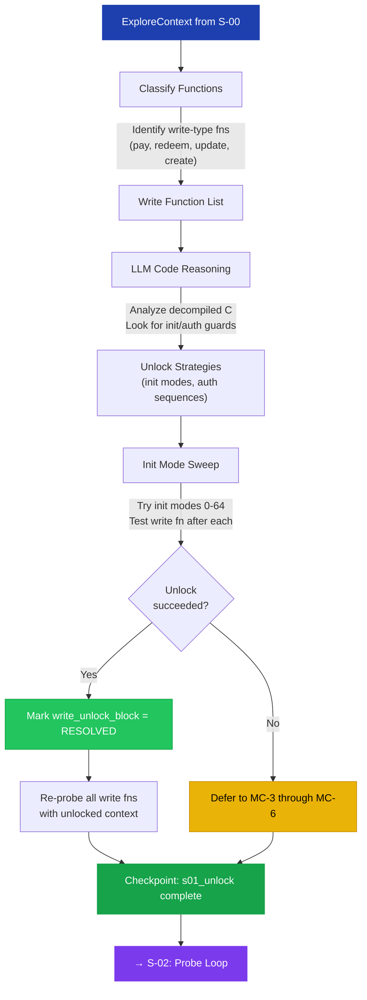

# S-01: Write-Unlock Probe — Flow

> **Input:** Foundational context from S-00 (sentinels, vocab, decompiled C)
> **Output:** Write-unlock status (resolved or deferred)

## Key Decisions at This Stage

- **Admitted S-00 slice first** reads the S-00 handoff packet when present and
  admits the narrowed `baseline_truth`, `surface_inventory`, and advisory
  `s01_targets` slice before probing.
- **Legacy fallback** keeps using existing `ctx.dll_strings`, `ctx.vocab`, and
  `ctx.sentinels` if the handoff packet is missing, thin, or malformed.
- **Write vs. read classification** uses function name heuristics (pay, process, redeem, update, set, create = write-type).
- **LLM code reasoning** reads the decompiled C to find init guards (`if (!g_initialized) return ERROR`).
- **Init sweep** systematically tries mode values. If a single mode unlocks writes, it's recorded for all downstream stages.

`s01_targets` is advisory in the current live contract. It improves input
organization by moving admitted targets earlier in probe order, but it does not
yet redesign the full unlock planner.

## Circular Enrichment

On subsequent runs, if the prior checkpoint already has `write_unlock_block = RESOLVED`, this entire stage is skipped. The unlock mode value is carried forward in the checkpoint, saving significant runtime.
