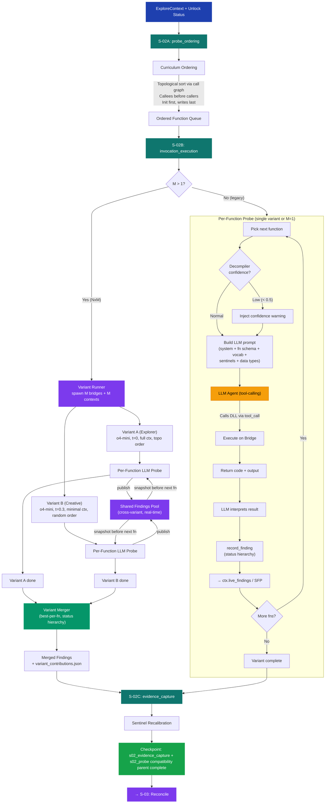

# S-02: Probe Loop — Flow

> **Input:** ExploreContext with sentinels, vocab, unlock status, call graph, data types
> **Output:** Per-function findings (call results, return codes, parameter semantics)
> **NxM:** M=2 in Phase 1 (Explorer + Creative variants); M=1 fallback identical to legacy.

## Key Decisions at This Stage

- **Runtime split identity**: S-02 now exposes `s02_probe_ordering`,
  `s02_invocation_execution`, and `s02_evidence_capture` while preserving
  `s02_probe` as the full-stage compatibility parent.
- **Curriculum ordering** uses topological sort on the call graph when available. Callees are probed before callers so their working calls are in `live_findings` first. Falls back to uncertainty score when no call graph exists.
- **Prerequisite-state groups** sit next to functional clusters. They do not replace curriculum ordering; they bound which prerequisite bootstrap surfaces are seeded and observed during floor-to-ceiling iteration.
- **NxM variant runner** (Phase 1 locked: M=2): spawns two bridge instances and two `ExploreContext` copies sharing a `SharedFindingsPool`. Until BUG-028 + bridge isolation land, runs sequential pseudo-M or M=1.
- **Shared Findings Pool (SFP)**: cross-variant real-time store. When Variant B discovers a working init, Variant A sees it on its next function probe. Publishes with the full status hierarchy.
- **Variant Merger**: after all variants finish, selects the best finding per function (`verified_success > functional_precondition_unmet > inferred_success > failure > unknown`). Writes `variant_contributions.json`.
- **Decompiler confidence warnings** inject a warning into the LLM prompt when Ghidra's confidence is low (< 0.5).
- **Data types in system message** — structs, enums, typedefs from Ghidra's DTM.
- **Per-function budget** is controlled by `max_rounds` and `max_tool_calls`.
- **Intra-stage finding propagation** (`live_findings` / SFP): function A's success is immediately available to function B within the same variant (and cross-variant via SFP).
- **Direct target truth provenance**: when probe reaches the right target call,
  the stage now preserves canonical `direct_target_truth` so later verification
  and harmonization do not need to reconstruct the strongest truth only from
  raw probe logs.
- **Sentinel recalibration** at stage boundary catches state changes from probing.

## Circular Enrichment

Prior run findings are loaded as context — the LLM sees what worked before and skips already-verified functions. The probe loop is the primary data-generation stage; all downstream stages consume its findings. **Within a single run**, `live_findings` (or SFP) ensures discoveries propagate forward immediately.
