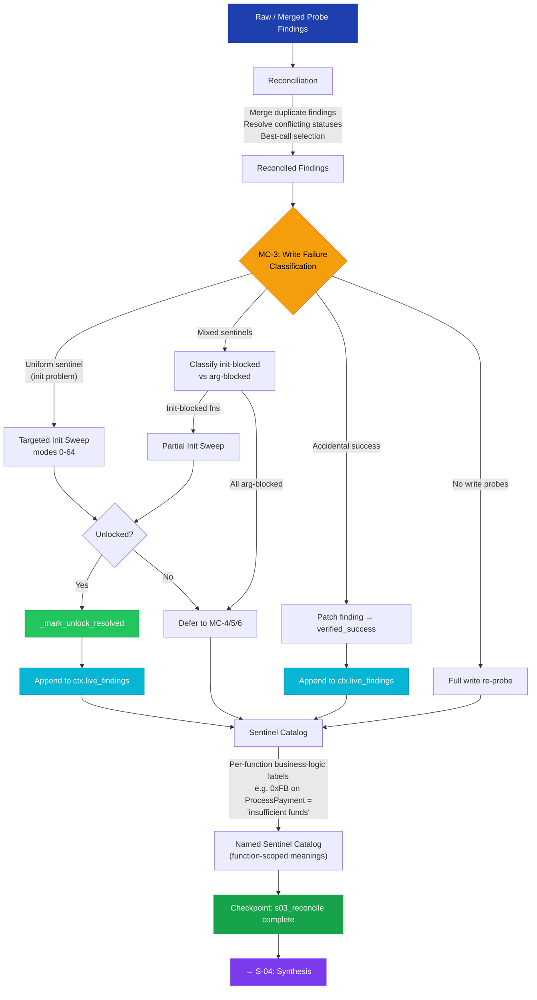

# S-03: Reconcile + MC-3 — Flow

> **Input:** Raw probe findings from S-02 (or merged findings from Variant Merger when M > 1)
> **Output:** Reconciled findings, write failure classification, sentinel catalog

## MC-3: Post-Reconcile Write Failure Classification

MC-3 is the first micro coordinator to run. It classifies the pattern of write failures:

| Pattern | Diagnosis | Action |
|---------|-----------|--------|
| All write fns return same error | Init/auth problem | Targeted sweep |
| Different errors per function | Classify init-blocked vs arg-blocked | Partial sweep + defer |
| Write fn returned 0 (success) | Recording error, not actual failure | Patch finding → `verified_success` |
| No write probes attempted | Curriculum skipped writes | Re-probe |

## Sentinel Catalog — Function-Scoped Semantics

The same numeric sentinel may mean different things on different exports (BUG-031). The catalog should store **per-function** labels where needed:
- `0xFFFFFFFB` on `ProcessPayment` → "insufficient funds"
- `0xFFFFFFFB` on `RedeemLoyaltyPoints` → "insufficient loyalty points (business precondition)"

This distinction feeds into `functional_precondition_unmet` classification downstream.

## Circular Enrichment

The sentinel catalog names become part of the LLM context for future runs. Instead of seeing `returned 0xFFFFFFFB`, the LLM sees a business-logic label — much more informative for reasoning about how to proceed.
