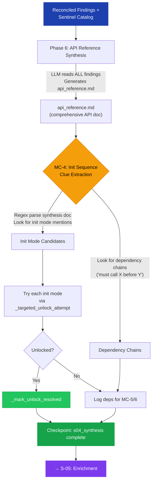

# S-04: Synthesis + MC-4 — Flow

> **Input:** Reconciled findings, sentinel catalog
> **Output:** API reference document, init sequence clues

## MC-4: Post-Synthesis Init Sequence Clues

MC-4 mines the LLM-generated synthesis document for unlock hints. The synthesis doc often contains phrases like:
- "Initialize with mode 2 to enable write operations"
- "CS_ProcessPayment requires CS_Initialize to be called first"

MC-4 extracts these programmatically and tests them.

## Circular Enrichment

The `api_reference.md` becomes a cumulative document. On subsequent runs, the synthesis incorporates prior-run findings, making it progressively richer. MC-4's discovered init modes feed back into S-01's checkpoint for future runs.
