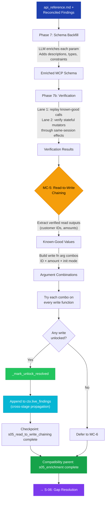

# S-05: Enrichment + MC-5 — Flow

> **Input:** Synthesis doc, reconciled findings, verified functions
> **Output:** Enriched MCP schema with backfilled parameters, verified descriptions

## MC-5: Read-to-Write Chaining

MC-5's key insight: if `CS_GetAccountBalance("CUST-001")` returned success, then "CUST-001" is a confirmed-valid customer ID. Chain it into `CS_ProcessPayment(customer_id="CUST-001", amount=100)`.

This is the "circular enrichment" pattern at its most concrete — read function outputs become write function inputs.

## Circular Enrichment

The enriched schema is the primary deliverable artifact. Each run refines parameter descriptions, constraints, and examples. Verification ensures descriptions match actual DLL behavior, not just LLM hallucination.

## Stateful Mutator Verification

Phase 7b now has two verification lanes:

- direct replay for existing success findings with concrete `working_call` evidence
- stateful mutator verification for near-success setter or writer calls discovered in the probe log

The second lane does not promote custom positive returns by itself. It rebuilds a fresh same-session lineage, runs the mutator, and promotes only when a downstream consumer or observer shows a deterministic effect.
