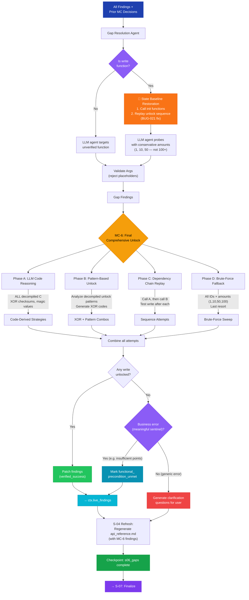

# S-06: Gap Resolution + MC-6 — Flow

> **Input:** All findings, enriched schema, all prior MC decisions
> **Output:** Resolved gaps, clarification questions for user, MC-6 comprehensive unlock
> **Next:** S-04 refresh (regenerate synthesis), then S-07 Finalize

## MC-6: Final Comprehensive Unlock

MC-6 is the most powerful coordinator. It has the richest context:
- All probe findings from S-02
- All MC-3/MC-4/MC-5 decisions and their outcomes
- Full decompiled C code
- Complete sentinel catalog (with function-scoped meanings)

It runs 4 phases in sequence, from most targeted to broadest sweep.

### `functional_precondition_unmet` Classification

When MC-6 cannot unlock a function but the return value is a **business-logic sentinel** (e.g. "insufficient points", "balance too low") and the call shape is valid, the finding is classified as `functional_precondition_unmet` — not `failure`. This status counts toward `discovered_rate` and signals the function works but runtime state is unsatisfied.

If the error is truly generic (access denied, not initialized), the pipeline generates clarification questions instead.

### S-04 Refresh

After MC-6, the runner re-invokes S-04 synthesis to regenerate `api_reference.md` with post-gap findings, avoiding a stale document that says "no working init found" when MC-6 already solved it.

## Circular Enrichment

MC-6's clarification questions are surfaced in the UI. When the user answers them, the answers feed into the next pipeline run as additional context. MC-6's decision history is also persisted, so subsequent runs know what was already tried and can avoid redundant work.
