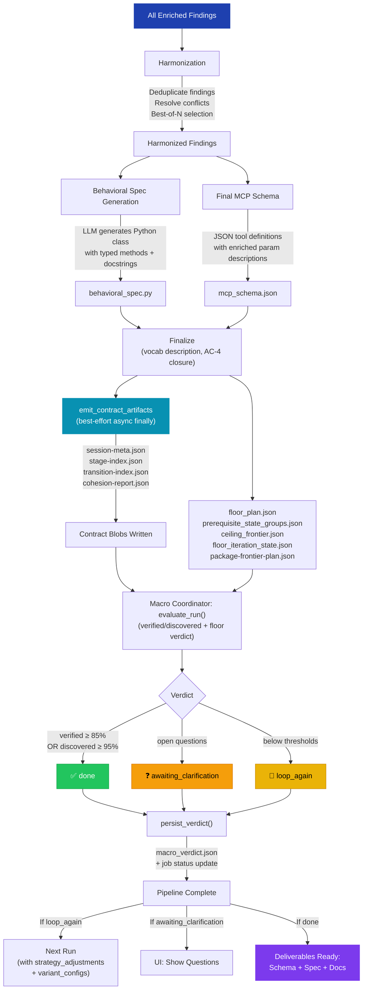

# S-07: Finalize — Flow

> **Input:** All findings, enriched schema, MC decisions, synthesis doc
> **Output:** Final harmonized schema, behavioral spec, Python wrapper, macro verdict, contract artifacts, floor-to-ceiling iteration artifacts when enabled, and package-frontier artifacts for package-floor campaigns



## Contract Artifact Emission

`emit_contract_artifacts` runs in a **best-effort asynchronous `finally`** block so the four contract JSON files are attempted even if harmonize or finalize raises partway through. Contract-artifact emission is surfaced through the `s07_emit_contract_artifacts` span and immediately deferred so terminal worker close is not blocked. The runner's **error handler** also performs a best-effort emission on fatal explore errors, so nightly ZIPs and save-session v2 can still validate transitions for post-mortems.

S-07 component-description synthesis is optional close-path enrichment. The
live default is deterministic description text. Opt-in model synthesis is
bounded at the stage layer and may degrade if the model client stalls; that
must not block final vocab persistence, schema-evolution evidence, or macro
verdict persistence.

Contract files required by `collect_session.py` (save-session v2):
- `session-meta.json` — job identity, timestamps, counts, profile
- `stage-index.json` — per-stage status, artifacts, errors
- `transition-index.json` — 18+ transition pass/fail records
- `cohesion-report.json` — gate results, summary, hard_fail flag

When `iteration_mode=floor_to_ceiling`, S-07 also persists:
- `floor_plan.json` — active floor scope, prerequisite-state groups, protected truths, and ceiling
- `prerequisite_state_groups.json` — resolved prerequisite bootstrap groups for the cycle
- `ceiling_frontier.json` — previous and next ceiling frontier
- `floor_iteration_state.json` — preservation verdict, carryover status, and next-cycle recommendation

When the active floor is `package`, the canonical package-facing artifact is:

- `package-frontier-plan.json` - imported lower-floor DLL truth, active package frontier, frontier entries, and package-floor observer contracts

Legacy `batch-b-ceiling-plan.json` remains a compatibility artifact for older sessions and transitional readers.

If floor broadening is intentionally blocked, S-07 still emits contract and
package artifacts with a valid `stage-index.json` skip explanation instead of
forcing the run to look degraded.

## Macro Coordinator Verdict

The macro coordinator runs deterministic rules using the **status taxonomy**:

| Coverage | Questions? | Verdict | Next Action |
|----------|-----------|---------|-------------|
| `verified_rate` ≥ 85% | — | `done` | Deliver artifacts |
| `discovered_rate` ≥ 95% | — | `done` | Remaining gaps are precondition-only |
| Any | Yes | `awaiting_clarification` | Show questions in UI |
| Below thresholds | No | `loop_again` | Suggest strategy adjustments + variant configs |

**Strategy adjustments** for `loop_again`:
- `focus_functions`: Top unresolved functions (up to 6)
- `skip_to_stage`: Skip setup/unlock if already resolved
- `focus_write_unlock`: Write-type failures detected → expand sweep
- DLL entry points (`entry`, `DllMain`) excluded from coverage calculation

## Circular Enrichment

The verdict and strategy adjustments are stored in the checkpoint. The UI's "Re-run with suggestions" button pre-fills explore settings from the verdict, enabling one-click circular enrichment.

## Full Pipeline Summary

```
DLL Binary
    ↓
S-00: Setup (sentinels, vocab, static analysis, call graph, data types)
    ↓
S-01: Write-Unlock Probe (code reasoning, init sweep)
    ↓
S-02: Probe Loop (per-function LLM agent; M=2 variants via SFP when enabled)
    ↓
S-03: Reconcile + MC-3 (write failure classification, function-scoped sentinel catalog)
    ↓
S-04: Synthesis + MC-4 (API reference, init clues)
    ↓
S-05: Enrichment + MC-5 (backfill, verify, read→write chain)
    ↓
S-06: Gap Resolution + MC-6 (comprehensive unlock, functional_precondition_unmet)
    ↓
S-04 refresh: Regenerate synthesis with post-gap findings
    ↓
S-07: Finalize (harmonize, behavioral spec, contract emission, verdict)
    ↓
Deliverables: mcp_schema.json + behavioral_spec.py + api_reference.md
              + session-meta / stage-index / transition-index / cohesion-report
```
