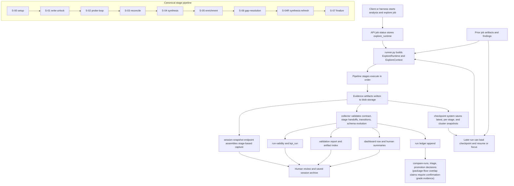

# System Overview And Dataflow

Primary code anchors:

- `api/pipeline/runner.py`
- `api/pipeline/core/handoff_contract.py`
- `api/pipeline/core/checkpoint.py`
- `api/routes/routes_session.py`
- `scripts/harness_lib/collector.py`

Notes:

- The chart uses the canonical stage sequence from `handoff_contract.py`.
- Session capture in `routes_session.py` still exposes some older stage folder names; treat that as a capture layout detail, not the canonical stage model.
- `S-05 enrichment` now includes both direct replay verification and same-session effect verification for stateful mutators with custom positive returns.
- Floor-to-ceiling package mode adds a package-frontier planning surface that
  can import lower-floor DLL truth and narrow live work to an active package
  frontier.
- Strict collection is contract-aware: an intentionally skipped broadening
  stage is valid when `stage-index.json` records an allowed floor-gated
  `skip_reason`.
