# Stage Model

> Mirror/explanatory surface only.
> Current implementation truth lives in
> `api/pipeline/core/handoff_contract.py`.
> Stage-split target doctrine lives in `docs/architecture/stage_split/`.

Primary code anchors:

- `api/pipeline/core/handoff_contract.py`
- `docs/architecture/ARCHITECT-OPERATING-GUIDE.md`

```mermaid
flowchart LR
    S00["S-00 setup<br/>static truth surface"] --> S01["S-01 write-unlock<br/>init, auth, gating"]
    S01 --> S02["S-02 probe-loop<br/>runtime evidence"]
    S02 --> S03["S-03 reconcile<br/>failure interpretation"]
    S03 --> S04["S-04 synthesis<br/>readable behavioral model"]
    S04 --> S05["S-05 enrichment<br/>schema, replay, and effect verification"]
    S05 --> S06["S-06 gap-resolution<br/>last hard blockers"]
    S06 --> S04R["S-04R synthesis-refresh<br/>regenerate after changed reality"]
    S04R --> S07["S-07 finalize<br/>durable artifacts and checkpoint"]

    S01 -. "vocab, static analysis,<br/>sentinel calibration" .-> S02
    S02 -. "findings and probe log" .-> S04
    S02 -. "findings and enrich calls" .-> S05
    S05 -. "schema-post-backfill" .-> S06
    S06 -. "schema-post-mini-session" .-> S04R
```

Interpretation:

- Earlier stages gather weaker-to-stronger evidence.
- Later stages should consume and operationalize earlier evidence instead of rediscovering it.
- S-05 is not only schema backfill. It is also the first stage that can promote a stateful mutator through same-session effect evidence instead of raw return-code replay alone.
- In floor-to-ceiling mode, broadening stages can be intentionally skipped when
  the floor contract blocks expansion; that is a contract-valid omission, not a
  broken session.
- Package-floor control sits above this stage model: it does not add new
  canonical stages, but it does constrain which stages should execute and what
  package artifacts must be emitted.
