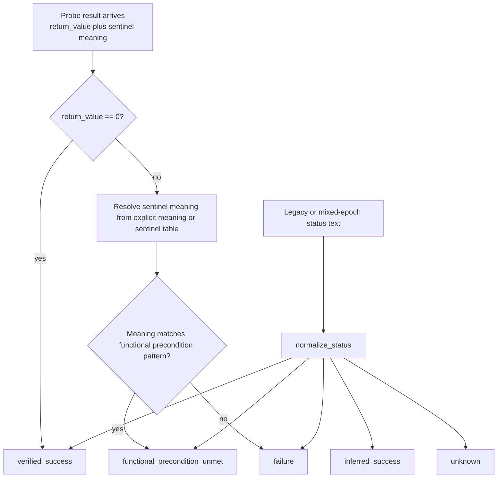
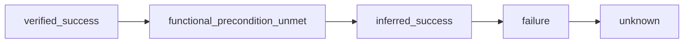

# Status And Classification

Primary code anchor:

- `api/pipeline/core/finding_status.py`

Canonical status order:

Interpretation:

- Runtime success is the strongest direct claim.
- Procedural success is not automatically reusable truth; semantically implausible
  working calls can be demoted before they become seed-eligible.
- Functional-precondition failures are treated as a stronger, more informative result than generic failure.
- Normalization exists so older capture formats remain comparable.
- Campaign attribution now also carries a package-carryover audit lane for
  regressed functions, so local-green/package-red mismatches can be upgraded
  from a blocker family into the first broken handoff and first broken
  invariant when local proof artifacts exist.
