# Context And Memory Model

Primary code anchors:

- `api/pipeline/core/types.py`
- `api/pipeline/s00_setup/context.py`
- `api/pipeline/s02_probe/context.py`
- `api/pipeline/core/checkpoint.py`
- `api/pipeline/core/cluster_checkpoint.py`

```mermaid
flowchart TD
    R["ExploreRuntime<br/>immutable run shape"] --> C["ExploreContext<br/>mutable pipeline state"]

    subgraph Runtime["Run-shape controls"]
        R1["caps and budgets"]
        R2["model and context density"]
        R3["prior_job_id and cross_dll_prior_job_ids"]
        R4["checkpoint_id and checkpoint_stage"]
        R4A["cluster checkpoint eligibility and reuse boundary"]
        R5["focus_functions, pass_index, and pass_scope_profile"]
        R6["skip_to_stage"]
    end

    subgraph Context["Mutable learned state"]
        C1["sentinels"]
        C2["vocab and use cases"]
        C3["static analysis and DLL strings"]
        C4["unlock_result and write_unlock_block"]
        C5["live findings and already_explored"]
        C6["evidence candidate registry"]
        C7["cost summary"]
    end

    R --> Runtime
    C --> Context

    P["Prior run artifacts"] --> C2
    P --> C1
    P --> C5
    P --> C6

    S00["S-00"] --> C1
    S00 --> C2
    S00 --> C3
    S01["S-01"] --> C4
    S02["S-02"] --> C5
    S02 --> C6
    S03["S-03"] --> C5
    S05["S-05"] --> C6
    S07["S-07"] --> P

    Q["Checkpoint snapshot"] --> C1
    Q --> C2
    Q --> C4
    Q --> C5
    Q --> C6
    Q --> R4A
```

Interpretation:

- `ExploreRuntime` answers what kind of run this is.
- Pass-specific ambition is now an explicit runtime control through
  `pass_index` and `pass_scope_profile`, not only an implicit curriculum habit.
- `ExploreContext` answers what the run has learned so far.
- Checkpoints and prior runs are memory inputs back into future runs, not just archival output.
- Findings can remain historical memory while still being marked ineligible for
  reusable truth promotion when expected-vs-observed alignment is too weak.
- Cluster checkpoints are lower-than-stage memory units for semantically coherent rerun surfaces.
- Cluster checkpoint rows are now machine-readable semantic memory, carrying
  `cluster_id`, `active_seam`, `gate_color`, `latest_trusted_proof_jobs`,
  exported artifact families (`live_artifact_families`), satisfied
  invariants, unresolved blockers, reuse eligibility, and `expected_next_move`.
- Seeded bounded reruns are identified by the tuple `checkpoint_id + checkpoint_stage + cluster_checkpoint_id`.
- Repeat investigations can now infer that tuple automatically from
  `prior_job_id + focus_functions` when the focused functions map uniquely to a
  canonical cluster checkpoint.
- Older checkpoints may lack newer cluster snapshot rows, so bounded-rerun readers must remain backward-tolerant and backfill canonical cluster metadata before deciding whether reuse is safe.
- Save, load, and stage-context refresh now all re-backfill cluster rows so the
  operational fields stay current instead of freezing as static metadata.
- The bootstrap artifact `explore_config.json` is now the canonical record of
  whether a run stayed cold, used an explicit cluster seed, or accepted a
  default inferred cluster seed.
- Repeated seeded passes now emit `convergence_summary.json`, which records
  proof time, gate color movement, pass count, reused truths, consumer
  coverage, and the remaining blocker for the bounded surface.
- Campaign truth now carries a first-class `cross_dll_contracts` surface for
  the narrow dependency class `business_object_continuity`, modeling shared
  runtime entity continuity across DLL boundaries.
- That contract surface exports the observed shared entity value, the required
  downstream source-job expectation, confidence floor, and the boundary
  observer verdict so campaign review can say whether the handoff held instead
  of merely noting that cross-DLL seeding existed.
