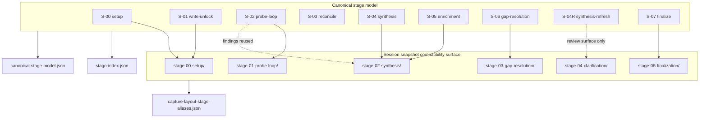

# Session Capture vs Canonical Stages

Primary code anchors:

- `api/pipeline/core/handoff_contract.py`
- `api/routes/routes_session.py`

Interpretation:

- The semantic stage model is `S-00` through `S-07`.
- The `stage-xx-*` folders in a saved session are compatibility layout, not the stage contract.
- `stage-04-clarification/` is a review surface, not a canonical pipeline stage.
- When a chart and a session folder disagree, trust the canonical stage model and the alias metadata.
- `stage-index.json` is also the canonical place to explain an intentional
  floor-gated skip such as `floor_broadening_blocked`; capture validity should
  follow that contract explanation rather than assume every skipped broadening
  stage is a failure.
- Schema-handoff and transition audits must ignore compatibility snapshots and
  edges owned by those intentionally skipped stages; otherwise floor-gated runs
  will be misclassified as regressions even when the skip contract is honest.
