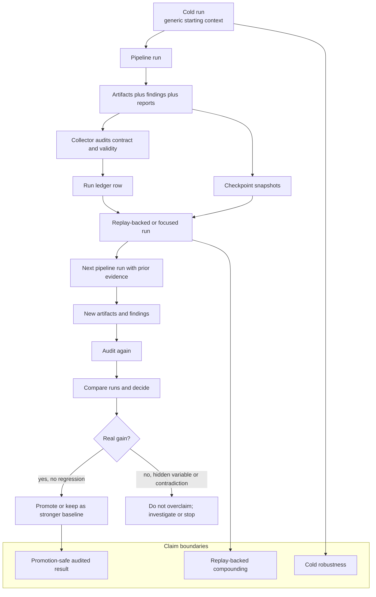

# Truth, Replay, Checkpoints, And Compounding

Primary code anchors:

- `api/pipeline/core/checkpoint.py`
- `scripts/harness_lib/collector.py`
- `docs/architecture/ARCHITECT-OPERATING-GUIDE.md`
- `docs/architecture/MVP-THESIS.md`

Interpretation:

- Replay-backed gains are real, but they are not the same claim as cold robustness.
- Checkpoints are both resume primitives and archival truth boundaries.
- Audits and ledger rows are what keep compounding from collapsing into fake progress.
