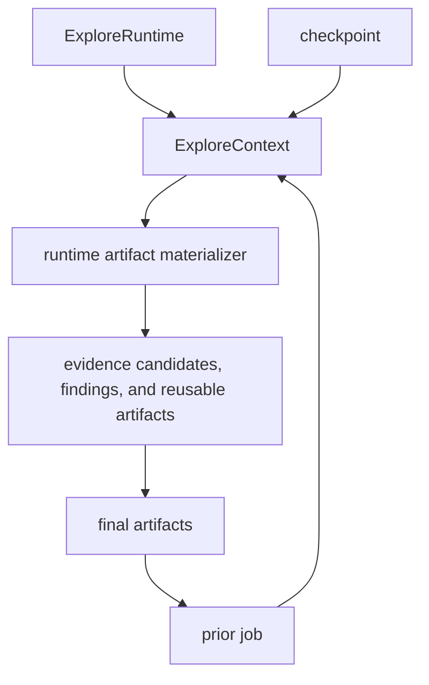

# Context And Memory Model

Current first-wave result:

- reusable runtime artifacts are helping some producer-consumer chains
- routing is still not reliable enough to treat this as a complete Tier 1 win
