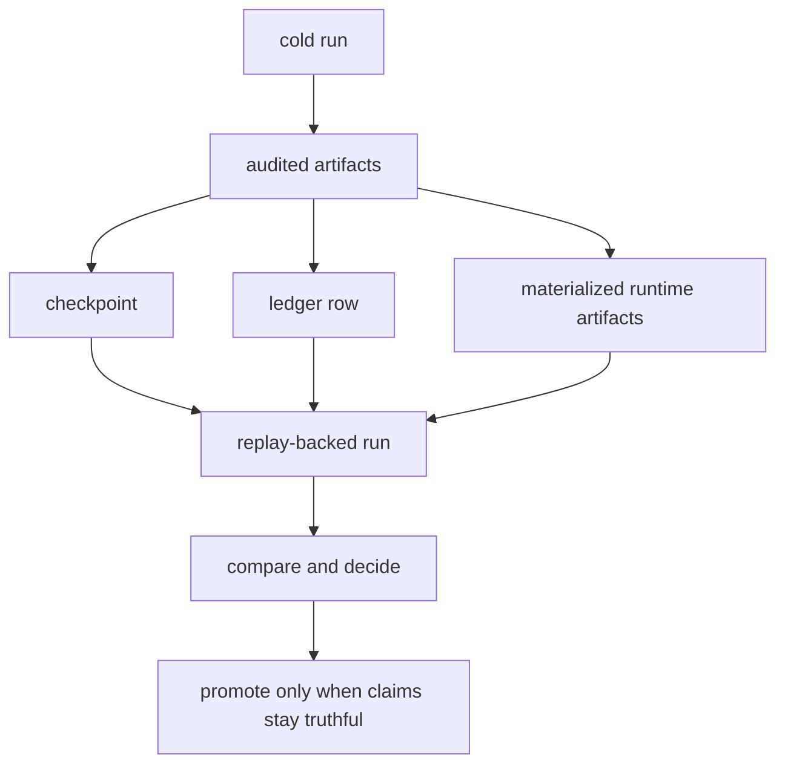

# Truth, Replay, Checkpoints, And Compounding

Current first-wave result:

- compounding improved some same-DLL state reuse,
- but the transport surface stayed flat and payments exposed a regression,
- so promotion should remain conservative.
