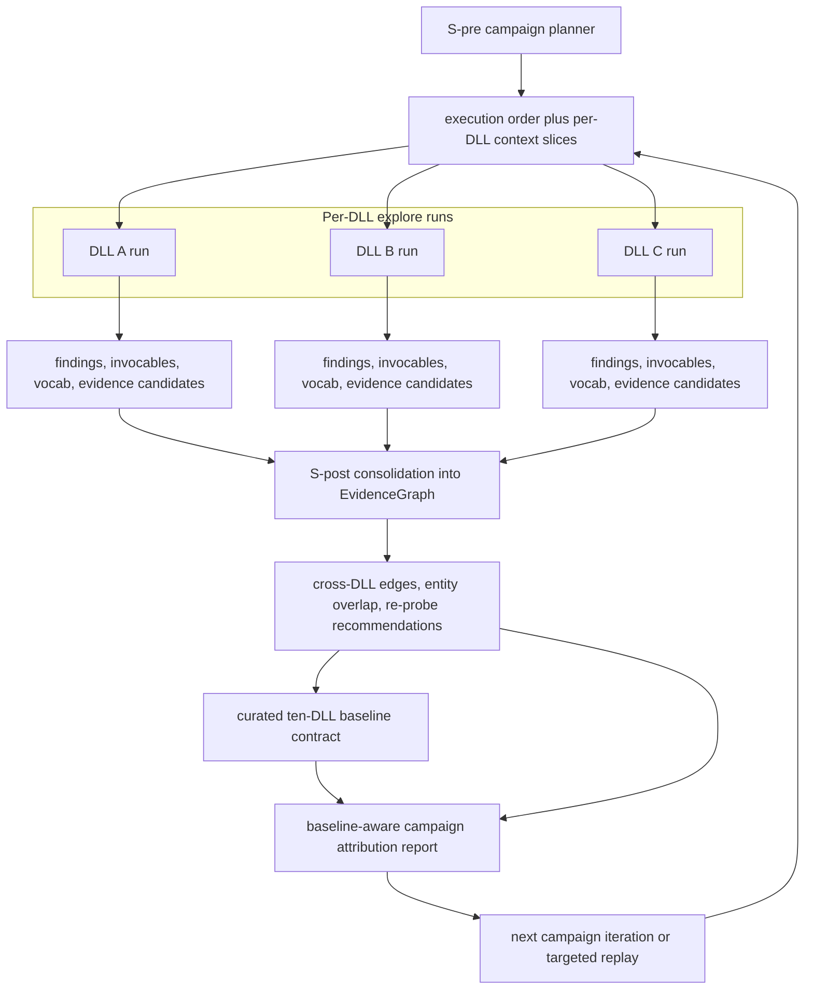

# Campaign And Cross-DLL Evidence Flow

Primary code anchors:

- `api/pipeline/core/campaign_stages.py`
- `api/pipeline/core/checkpoint.py`
- `api/pipeline/core/types.py`

Interpretation:

- Cross-DLL novelty lives in shared evidence becoming controlled future context.
- Campaign orchestration is not just batch execution; it is graph-backed learning across DLL boundaries.
- The attribution report is the architect-facing layer that turns campaign artifacts into next-system and regression decisions.
- Once the suite has a curated benchmark control, the attribution layer should compare against that contract first and only use ledger fallback when the curated baseline is absent.
- The attribution layer must mark explicit surface mismatches as `incomparable` instead of flattening them into false "flat" or false regression judgments.
- Clean-control decisions and historical-wave decisions are related but not identical: stronger repaired anchors may remove old apparent gains from the current control surface without invalidating the historical implementation lesson.
