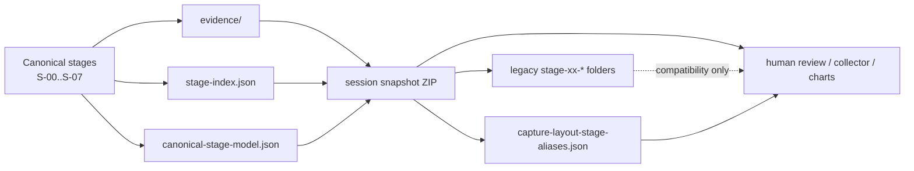

# Session Review Surface vs Canonical Stages

Primary code anchors:

- `api/pipeline/core/handoff_contract.py`
- `api/routes/routes_session.py`
- `scripts/harness_lib/collector.py`

Interpretation:

- The snapshot is a review bundle, not the source of truth for stage semantics.
- The canonical model should drive charts, explanations, and future architecture work.
- The legacy session folders remain useful for compatibility, but they should be read through the alias map.
