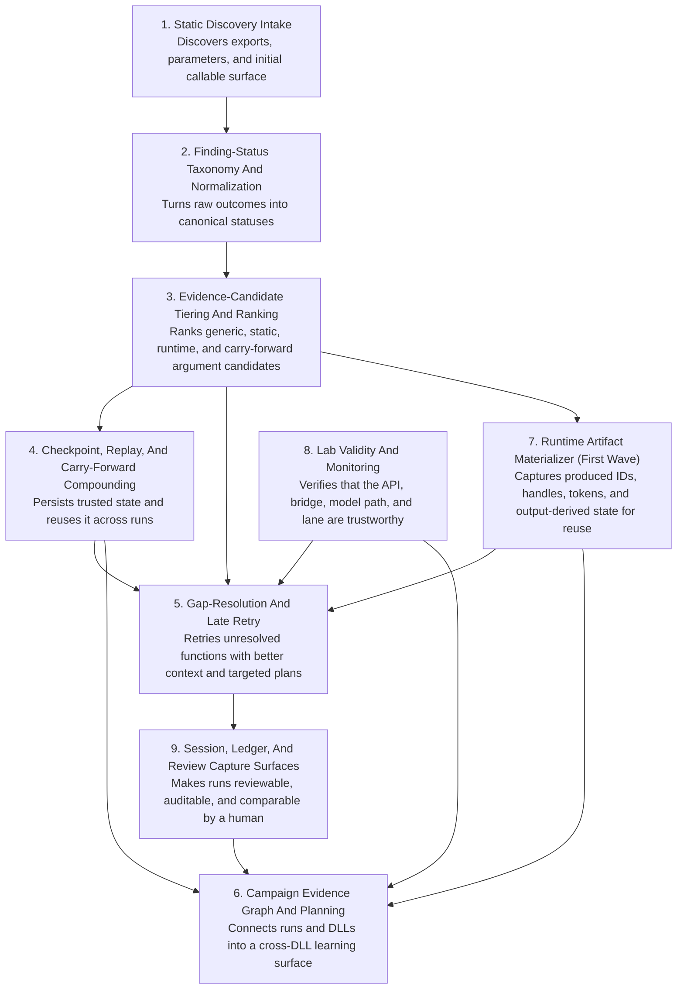

# System Register And Purpose

This chart answers a different question than the stage charts.

- stages explain **when** work happens
- systems explain **what reusable mechanism** is doing the work

## Reading Note

The important architectural point is overlap:

- a stage can involve multiple systems
- a system can span multiple stages

That overlap is expected when the system is layered rather than redundant.

## Current Interpretation

The most important active Tier 1 system is still:

- `runtime artifact materializer`

But it sits on top of older systems rather than replacing them.
