# Stage To System Correlation

This chart shows the top-down relationship between canonical stages and the
major systems currently in play.

```mermaid
flowchart TD
    P["Pipeline"] --> S00["S-00 setup"]
    P --> S01["S-01 write-unlock"]
    P --> S02["S-02 probe-loop"]
    P --> S03["S-03 reconcile"]
    P --> S04["S-04 synthesis"]
    P --> S05["S-05 enrichment"]
    P --> S06["S-06 gap-resolution"]
    P --> S04R["S-04R synthesis-refresh"]
    P --> S07["S-07 finalize"]

    SYS1["Static discovery intake"] --> S00
    SYS2["Finding-status taxonomy and normalization"] --> S02
    SYS2 --> S03
    SYS2 --> S05
    SYS2 --> S06
    SYS2 --> S07
    SYS3["Evidence-candidate tiering and ranking"] --> S01
    SYS3 --> S02
    SYS3 --> S06
    SYS4["Checkpoint, replay, and carry-forward compounding"] --> S00
    SYS4 --> S02
    SYS4 --> S04
    SYS4 --> S05
    SYS4 --> S06
    SYS4 --> S07
    SYS5["Gap-resolution and late retry"] --> S06
    SYS6["Campaign evidence graph and planning"] --> S00
    SYS6 --> S06
    SYS6 --> S07
    SYS7["Runtime artifact materializer, first wave"] --> S02
    SYS7 --> S05
    SYS7 --> S06
    SYS8["Lab validity and monitoring"] --> S00
    SYS8 --> S02
    SYS8 --> S05
    SYS8 --> S06
    SYS8 --> S07
    SYS9["Session, ledger, and review capture surfaces"] --> S07

    classDef stage fill:#eef6ff,stroke:#5b7c99,color:#0f2437;
    classDef system fill:#f8f3e7,stroke:#8f6b2d,color:#3e2d10;
    class S00,S01,S02,S03,S04,S05,S06,S04R,S07 stage;
    class SYS1,SYS2,SYS3,SYS4,SYS5,SYS6,SYS7,SYS8,SYS9 system;
```

## What This Means

Two points matter:

1. The stage ladder is not the same as the system register.
2. Overlap is allowed when the systems are layered and non-duplicative.

Examples:

- `runtime artifact materializer` mainly influences probe, enrichment, and gap
  reuse behavior.
- `lab validity and monitoring` is operational and cross-cutting, not
  stage-local.
- `campaign evidence graph and planning` sits above single-stage execution and
  turns runs into a broader learning surface.
